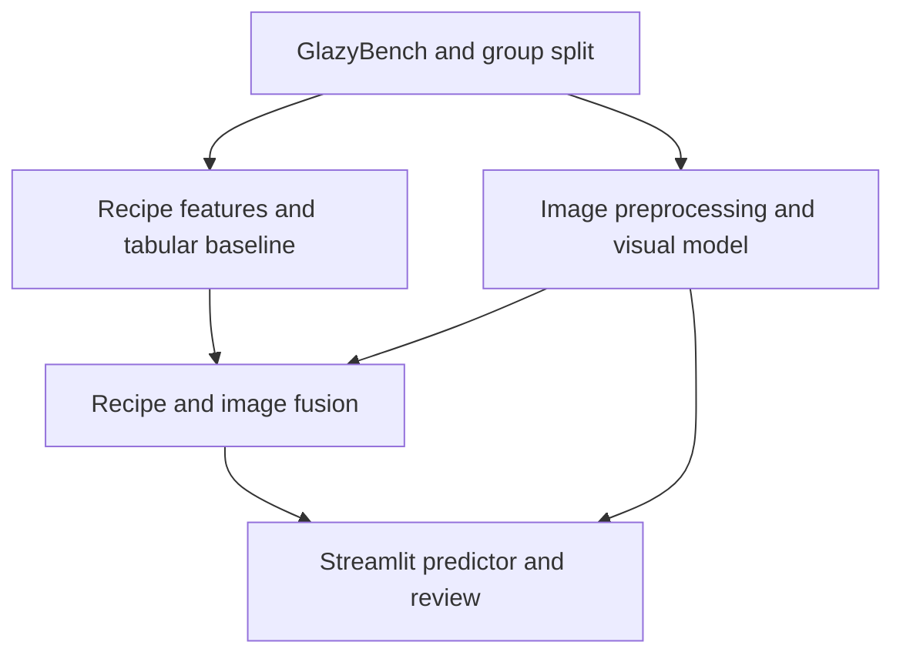

# GlazeVision: Multimodal Deep Learning for Ceramic Glaze Prediction

Predict a ceramic glaze's finish from the recipe, the fired sample's photo, or both.


A DEPI IBM Data Science graduation project based on Project 3, Classify Ceramic Glaze
Results. Firing test pieces takes time and ingredients. A recipe-only estimate can
prioritize experiments before firing. A photo supports finish review after firing.

## Dataset

[GlazyBench](https://huggingface.co/datasets/AlpachinoNLP/GlazyBench) and the
[benchmark paper](https://arxiv.org/abs/2605.06641) provide recipes and a paired
image subset. See [the data guide](data/README.md) for schemas, download instructions,
label mapping and the recipe grouping method. Surface finish is the primary target.
Transparency and color family are auxiliary classification tasks in the fusion model.

## Architecture



## Start locally

```bash
python -m venv .venv
source .venv/bin/activate
python -m pip install -r requirements.txt
python scripts/download_data.py --metadata-only
python scripts/make_split.py
streamlit run app/streamlit_app.py
```

Run the downloader again without `--metadata-only` before image training. The app can
start without data or weights and marks placeholder predictions. For Colab, open
`notebooks/00_quickstart_colab.ipynb`, enter the repository URL, then select GPU for
image or fusion work. Checkpoint exports are local. Deploying the app is optional.

## Repository and team

`configs/` holds shared settings, `scripts/` prepares data, `src/glazevision/` holds
reusable code, `notebooks/` contains experiments, and `app/` contains the demo.
`reports/` holds experiment outputs and `presentation/` holds the slide outline.

| Role | Name | Scope |
|---|---|---|
| P1 | TBD | Data, EDA, group split |
| P2 | TBD | Classical ML and majority baseline |
| P3 | TBD | Chemistry features and clustering |
| P4 | TBD | Image pipeline and CNN |
| P5 | TBD | Advanced models, Grad-CAM and uncertainty |
| P6 | TBD | Fusion, app, integration and presentation |

## Shared interfaces

- `data/splits/split.csv` has `sample_id,split,group_id`. Use it for every experiment.
- Use seed 42. Keep class lists and finish mapping in `configs/config.yaml`.
- Record results through `utils.save_results()` using the header in `reports/results.csv`.
- Call `predict(image=None, recipe=None)` with a PIL image and/or recipe dictionary.
  The result contains probability mappings for `surface`, `transparency` and `color_family`,
  plus `confidence`, `uncertain`, and `gradcam` (NumPy array or `None`).
- Weight loading uses `models/best_fusion_model.pt`. Change `CHECKPOINT` to select a
  different compatible export. Restart the app after replacing weights.

## Evaluation and DEPI submission

| Check | Evidence to submit |
|---|---|
| Held-out groups | Split file, group leakage check and label counts by split |
| Per-class results | Precision, recall, F1, support and saved confusion matrices |
| Simple baseline | Majority-class model from the classical ML notebook |
| Error and uncertainty review | Saved review CSVs, calibration coverage and annotated examples |
| Reproducibility | Data instructions, notebooks, model comparison and findings report |
| Human oversight | Low-confidence flag and finish-review wording across the demo |

Use the validation split for tuning and conformal calibration. Lock choices before
the final test run. Compare ablations on identical paired rows using image-side
labels, including recipe-only ablation. Full tabular benchmark and paired ablation
are different cohorts.

| Model | Cohort | Macro F1 |
|---|---|---|
| Pending team experiments | — | — |

## Limits and acknowledgements

Lighting, camera processing and glaze photography can affect apparent gloss and color.
Model outputs support finish review and cannot establish safety, durability or food
contact suitability. Missing kiln batch and cooling fields limit causal interpretation.
Recipe-only inference assumes inputs comparable to the training source. Compare manual
entries against held-out examples with matching feature availability.

Thanks to the Glazy community, the GlazyBench authors and the DEPI instructional team.
This repository's code uses MIT. Hugging Face marks the benchmark package MIT.
Original Glazy images and metadata have separate terms; see
[Glazy data licensing](https://github.com/derekphilipau/glazy-data).
Do not commit or redistribute dataset files from this repository.

For initial experiments, the runner defaults to validation. Pass
`evaluation_split="test"` only after locking the choices. Conformal coverage
uses validation for calibration and test for assessment. Grad-CAM uses the
exported convolutional image model and explains that model's prediction.
